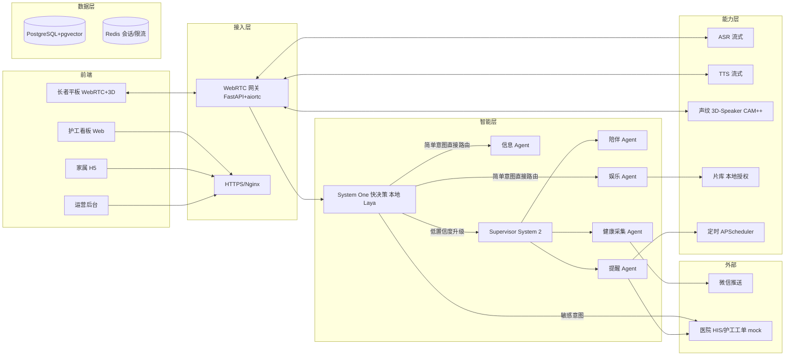

# 「康伴」3D 数字人康养陪伴系统 · 技术规范

> 版本：v1.0 ｜ 阶段：2/7 ｜ 上游输入：`01_PRD_康伴数字人.md`（定稿）+ 大纲第六/七/八/九章
> 本文档定义**怎么做**：架构、Agent Harness、身份体系、数据模型、接口与性能指标。

---

## 一、文档定位与目的

把 PRD 的业务范围翻译为**可实施、可测试、可部署**的工程规格。所有架构决策、数据字段、接口能力必须落在 PRD 划定的功能范围内，且不触犯边界 B1–B11。

## 二、输入物

| 输入 | 来源 |
| --- | --- |
| PRD 定稿（功能/目标/边界/权限） | `01_PRD_康伴数字人.md` |
| 总体架构与 Agent Harness | 大纲第六章 |
| 身份识别与权限体系 | 大纲第七章 |
| 数据模型概要 | 大纲第八章 |
| 技术栈映射 | 大纲第九章 |

## 三、责任主体

| 角色 | 职责 |
| --- | --- |
| 技术负责人 | 定稿架构、数据模型、接口规范 |
| 安全/合规负责人 | 评审身份体系与数据模型是否违反 B5/B8 及三道闸门 |
| 测试负责人 | 确认性能指标可测、可复算 |

## 四、业务边界约束（B1–B11 在本阶段的落地）

| 边界 | 技术规范层面的强制要求 |
| --- | --- |
| B1 不做医疗诊断 | 健康 Agent 输出 schema 仅含"采集值 + 分级（绿/黄/红）"，**不含诊断字段**；告警话术库统一为"建议问医生" |
| B3 不做高精度 3D/动捕 | 前端仅允许加载现成 VRM + viseme 口型驱动，不引入建模/动捕依赖 |
| B4 不做 AI 歌曲生成 | 娱乐 Agent 只有"检索/播放/语音控制"工具，**无生成类模型** |
| B5 不依赖商业 Jev API | System One 服务为**本地推理进程**；网络策略禁止向第三方推理 API 外发原始语音文本 |
| B6 不做盗版曲库/影库 | `media_library` 全量记录 `copyright_status ∈ {授权, 公有领域, 教学模拟}`；无任何抓取/爬取模块 |
| B7 不接支付/采购/门禁 | 外部依赖白名单仅：微信推送、医院 HIS/护工工单（教学 mock） |
| B8 不存完整病历/原始录音 | 表结构不含完整病历/原始音频字段；音频中间件带 72h TTL |
| B9 不做原生 App | 家属端为无框架 H5（服务端渲染 HTML+JS） |
| B10 不做多租户 | 数据库无 `tenant_id` 抽象；部署为单实例单社区 |
| B11 不做 diarization | ASR 输出仅单说话人文本；重叠检测触发"谁在说话"澄清话术 |

## 五、总体架构

确定性路由骨架 + 主控 Agent，**三层分工**：高频确定的走规则/分类器直接执行，复杂多步的进入受约束主控 Agent。

### 主控 Agent 的硬约束（必须落为代码机制）
- `elder_id` 由设备/声纹确定后**强制注入**，不接受模型传入。
- 全局 `MAX_TOOL_CALLS_PER_TURN = 8` + 重复检测，防死循环。
- 高危副作用（通知陪护、对接医院、建工单）走 LangGraph 子图 + HITL，不自动越级。
- 用药、健康子图统一由主控 Agent 调用。

## 六、Agent Harness 组成

| Harness 组件 | 本项目的实现规格 |
| --- | --- |
| Context | 注入 `elder_id / room_id / device_id / persona_config / time / weather` |
| System One 快决策 | Chinese-Jev/Laya 本地推理，一次返回：意图分类、敏感标记、升级建议、隐私收敛信号 |
| Tool | 用药查询、健康记录、戏曲/电影检索、信息搜集、工单创建、家属通知 |
| State/Checkpoint | LangGraph Checkpointer，按 `thread_id` 持久化到 PostgreSQL |
| Memory | 短期=对话历史；长期=pgvector 按 `elder_id` 隔离；画像=关系型表 |
| Loop | 每 Agent 独立运行循环，Supervisor 分发汇总；S1 命中直接短路 |
| Policy | 单次对话 ≤8 次 Tool；敏感操作人工确认；越权拒绝；置信度 <0.85 必须升级 |
| Recovery | Tool 失败重试 2 次后降级话术；Checkpoint 恢复断线；快决策加载失败降级"全走大模型" |
| Observability | 每次对话记录 Trace（分类结果、置信度、是否升级、Tool、耗时），敏感字段脱敏 |
| Evaluation | 固定 20 场景测试集，回归对话质量、权限正确性、快决策准确率 |

## 七、身份识别四层锚点（承接大纲 7.1）

1. **L1 设备绑定**：`device_id → room_id → bed_id`，后台运营配置。
2. **L2 房间默认住户**：单人间直接锁定；双人间给候选列表。
3. **L3 声纹识别**：3D-Speaker CAM++，cosine ≥0.85 锁定。
4. **L4 主动确认兜底**：开口问"是王奶奶吗？"；护工刷工牌临时 token。

- 通过 → Runtime Context 注入 `elder_id + confidence + source`。
- 失败 → 降级通用模式（不带任何个人记忆）。

## 八、三道隔离闸门（必须写测试，详见阶段 4）

1. **会话隔离**：`thread_id` 按 `(elder_id, session_seq)` 生成；伪造他人 thread_id 返回 403。
2. **记忆隔离**：pgvector 查询强制带 `WHERE elder_id = :runtime.elder_id`。
3. **工具授权**：Tool 从 `runtime_context.elder_id` 读身份，不信任客户端/模型生成的 `elder_id` 参数。

## 九、数据模型（11 张表，SQLAlchemy 2.x + Alembic）

> 基准为大纲第十章 Day 1.3「一次定全 11 张表」。命名以本表为准，与大纲第八章的字段说明对齐；字段实现时**不得新增**任何完整病历/原始音频字段（B8）。

| 表 | 关键字段 | 说明 | 边界约束 |
| --- | --- | --- | --- |
| `rooms` | room_id, bed_count, occupant_ids[] | 房间信息 | — |
| `devices` | device_id, room_id, device_jwt, status | 平板设备与房间绑定 | — |
| `elders` | elder_id, name, birth_date, gender, persona_id, status | 长者档案 | 不含病历字段（B8） |
| `personas` | persona_id, name, avatar_url, personality, greeting, voice_id | 人设模板 | 仅现成 VRM 引用（B3） |
| `memory_chunks` | chunk_id, elder_id, content, embedding(vector), category, created_at | 长期记忆向量 | 强制 `elder_id` 隔离 |
| `medication_plans` | plan_id, elder_id, drug_name, dose, schedule, start/end_date | 用药计划 | — |
| `media_library` | media_id, type(opera/movie), title, genre, era, artist, media_url, duration, copyright_status | 素材库（教学模拟） | `copyright_status` 仅授权/公有领域/教学模拟（B6） |
| `health_records` | record_id, elder_id, recorded_at, bp, sleep, mood, chief_complaint | 每日健康采集 | 仅结构化摘要（B8） |
| `voiceprints` | elder_id, embedding(vector), sample_url, created_at, expires_at | 声纹注册库 | embedding 加密存储 |
| `work_orders` | order_id, elder_id, type, status, assignee_id, created_at | 护工工单 | — |
| `conversations` | thread_id, elder_id, device_id, started_at, ended_at, identity_source | 会话索引 | 不存原文音频（B8） |

> **命名/字段对齐说明**：大纲第八章另有 `decision_logs`、`media_history`、`staff_tokens` 三张辅助表（快决策日志、点播历史、护工临时 token）。它们作为上表 11 张主表之外的**审计/辅助表**，用于评测误判分析、点播偏好学习与护工临时访问，不改变主表定稿结论。落地时由技术负责人决定并入主迁移或作为辅助表，但不得触碰 B8/B6 边界。

## 十、接口与技术栈映射

| 课程能力 | 落地规格 |
| --- | --- |
| Python/异步 | WebRTC 异步流、并发会话管理 |
| SQLAlchemy/Alembic | 业务表 CRUD、事务、迁移 |
| LLM API/流式/结构化 | 多轮对话、Pydantic 健康记录、Token 成本控制 |
| Tool Calling | 用药查询、戏曲/电影检索、工单、信息搜集等 Tool |
| RAG/pgvector | 长期记忆检索、家属日报引用、权限 metadata 过滤 |
| LangGraph | Supervisor+子 Agent、Checkpoint、Interrupt 人工确认 |
| Agent Harness | 上下文注入、预算、恢复、Trace、评测集、S1/S2 双路由与降级 |
| 多 Agent/MCP | 五子 Agent；HIS/微信封装为 MCP Server |
| FastAPI/SSE/JWT/pytest | HTTP API、WebRTC 信令、角色鉴权、自动化测试 |
| Docker/CI/可观测 | Compose 部署、HTTPS、日志/Trace、回滚演练 |
| System One 决策模型 | 接入 Chinese-Jev/Laya 开源权重，实现意图分类/敏感拦截/置信度升级 |

## 十一、性能与容量指标（须可测）

| 指标 | 目标 | 测量方法 |
| --- | --- | --- |
| 端到端延迟 | ≤1.5s（P95） | 关键节点打点聚合 `metrics`，跑 20 次取 P95 |
| System One 分类延迟 | ≤200ms | 单句推理计时 |
| System One 准确率 | ≥90% | 50 条标注样例 |
| 敏感意图召回率 | ≥95% | 敏感样例集 |
| S1 闭环率 | ≥60% | 分层命中统计（规则/Laya/主控占比） |
| 身份识别准确率 | 单人间 ≥99%、双人间 ≥90% | 设备绑定/声纹验证报告 |
| 单会话 Tool 调用 | ≤8 次 | `MAX_TOOL_CALLS_PER_TURN` |

## 十二、降级矩阵（承接大纲十二章）

| 风险 | 降级方案 |
| --- | --- |
| 声纹不准 | 低置信主动确认；再失败走通用模式 |
| S1 加载失败/超时 | 降级"全部走大模型"，日志告警 |
| 快决策误判 | 评测集回归；敏感宁可错杀；decision_logs 留痕 |
| ASR/TTS 不可用 | 文字提示 + 转护工工单 |
| 片库加载失败 | 语音致歉并推荐其他内容，不白屏 |
| 版权争议 | 只用教学样例，README 明确版权边界 |
| WebRTC 失败 | 降级 HTTP 文字聊天（平板大字模式） |
| LLM 超时/限流 | 重试 1 次，失败用预设话术兜底 |
| 误触/陌生人 | 非登记身份 30 秒无操作自动锁定设备 |

## 十三、输出物

- 本技术规范定稿。
- `docs/ER_数据模型设计.md`（11 张表全量，Day1 定稿，复用仓库已有文档）。
- 架构图（mermaid）与接口清单（FastAPI 路由 / WebRTC 信令 / MCP 工具 schema）。

## 十四、完成标志（DoD）

- [ ] 架构三层分工、主控 Agent 五条硬约束全部落为规格。
- [ ] 11 张主表字段定稿，无 B8 违例字段、无 B6 违例来源、无 B10 租户字段。
- [ ] 四层身份锚点 + 三道闸门 + 权限矩阵映射完整。
- [ ] 每条性能指标有明确测量方法。

## 十五、校验标准

| 校验项 | 通过标准 |
| --- | --- |
| 边界落地 | B1–B11 在"边界约束"章节均有技术层强制要求 |
| 数据模型合规 | 无完整病历/原始音频字段（B8）；media_library 强制 copyright_status（B6） |
| 身份体系完整 | 四层锚点、三道闸门与权限矩阵与大纲七章一致 |
| 指标可测 | 十一节每条指标含测量方法，可为阶段 7 验收提供判据 |
