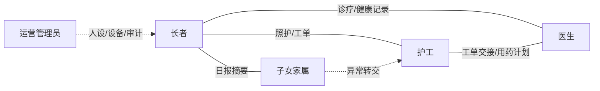
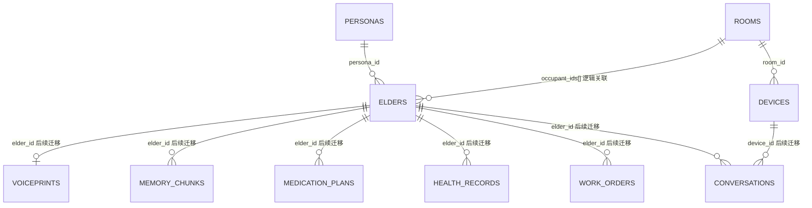

# 「康伴」3D 数字人康养陪伴系统 · ER 数据模型设计

> 版本：v1.0 ｜ 阶段：Day 1 ｜ 上游输入：`02_技术规范.md` 第九节（11 张表）、`01_PRD_康伴数字人.md` 第八节（权限矩阵）、`03_安全与合规审计.md`
> 本文档定义五类核心角色的边界、权限矩阵、实体关系与四张核心表的落地字段。字段唯一来源为 `02_技术规范.md` 第九节；本文不新增规范外表内字段。

---

## 一、范围与依据

| 项 | 约束 |
| --- | --- |
| 主表数量 | 11 张；`rooms`、`devices`、`elders`、`personas` 四张完整建表，其余 7 张仅建主键占位 |
| 字段来源 | `02_技术规范.md` 第九节；四张核心表字段数分别为 3、4、6、6，逐字段对应 |
| 角色来源 | `01_PRD_康伴数字人.md` 第 5.3 节与第八节权限矩阵 |
| 强制边界 | B1 不诊断、B2 不替代 SOS、B3 仅现成 VRM、B5 S1 本地推理、B6 版权合规、B8 不存完整病历/原始录音、B10 无多租户 |
| 角色存储 | 五类角色是认证主体，不是主表实体；角色由 JWT claims + `runtime_context` 表达，不新增 `roles` 表 |

## 二、五类核心角色

| 角色 | 业务定义 | 职责边界 | 适用场景 | 关键关联 |
| --- | --- | --- | --- | --- |
| 长者 | 社区在住长者，系统主要用户；通过设备绑定、声纹或主动确认确定身份 | 只能访问本人数据；可语音播报本人健康记录；可发起删除声纹/记忆申请；不能修改用药计划、不能配置人设 | 卧室平板对话、用药提醒、健康采集、娱乐点播、本人健康查询 | 与 `rooms.occupant_ids`、`elders.elder_id` 绑定；与护工、医生、家属存在照护/诊疗/亲属关系 |
| 护工 | 社区轮班照护人员，按房间/长者分工；必须进入工作模式才获得业务权限 | 工作模式下可访问照护范围内长者的完整对话与健康记录；修改用药计划需二次确认；仅在退房流程中可删除声纹/记忆；不能配置人设 | 护工看板、异常处理、用药计划维护、退房办理、工单处理 | 通过工单 `assignee_id`（后续字段）与长者关联；与医生交接用药/异常 |
| 医生 | 合作医院查房医生，按授权长者范围提供诊疗支持 | 可查看授权长者完整健康记录；可修改用药计划；可创建工单；不能访问个性化对话、不能配置人设、不能删除声纹/记忆 | 每周查房、健康趋势查看、用药调整、红色健康告警处置 | 通过健康记录与用药计划关联长者；与护工交接工单 |
| 子女家属 | 与长者绑定的亲属账号；异地了解长者每日状态 | 仅可查看日报摘要；不可访问原始健康数据、个性化对话、用药计划、工单创建、人设配置、删除操作 | 家属 H5 查看日报、接收微信推送 | 与长者存在亲属绑定关系；异常信息由护工转交 |
| 运营管理员 | 社区运营人员，负责设备、房间、人设与审计类操作 | 仅可配置人设/形象；可执行审计类删除；不可查看健康记录、个性化对话、用药计划；不可创建工单 | 人设模板配置、设备/房间绑定、退房审计、权限配置 | 配置 `personas`、`devices`、`rooms`；与护工/医生仅为账号与权限管理关系 |

### 2.1 上下文身份：同房间其他长者

“同房间其他长者”不是第六类核心角色，而是长者在 `rooms.occupant_ids[]` 中的同住关系。其权限仅限：

- 个性化对话：只能进入隐私收敛模式，不得读取长者本人完整记忆或敏感内容；
- 创建工单：可发起工单；
- 健康记录、用药计划、人设配置、删除声纹/记忆：一律拒绝。

家属、访客即使物理上处于同一房间，也不因“同房间”获得账号权限；平板现场只提供通用模式。

### 2.2 角色互斥与判定优先级

| 规则 | 说明 |
| --- | --- |
| 身份只认 token | 人类角色认人 JWT；设备认设备 JWT；`elder_id` 只从 `runtime_context` 取，不信任请求体 |
| 拒绝优先 | 任一条件不满足即拒绝，不做“部分放行” |
| 工作模式 | 护工权限以班次、房间/长者范围、工牌 token 同时有效为前提；下班即失效 |
| 医生范围 | 医生仅限被授权长者；跨长者访问按越权处理 |
| 管理员无内容权 | 管理员可配置与审计，但不得读取临床/对话内容 |
| 同房间收敛 | 同房间其他长者只获得通用陪伴内容，敏感记忆、用药、健康、家属信息一律隐藏 |

## 三、角色间关联关系



| 关联 | 关系性质 | 数据/流程依据 | 边界 |
| --- | --- | --- | --- |
| 长者—护工 | 照护责任关系 | 房间入住、工单受理、用药计划维护 | 护工必须在工作模式且处于照护范围 |
| 长者—医生 | 诊疗责任关系 | 健康记录、用药计划、红色告警 | 医生仅限授权长者，不进入陪伴对话 |
| 长者—子女家属 | 亲属绑定关系 | 家属账号与长者绑定、日报摘要 | 家属只看摘要，不看原始数据 |
| 长者—运营管理员 | 运营配置/审计关系 | 人设、设备、房间、删除审计 | 管理员不读取临床与对话内容 |
| 护工—医生 | 工单/用药交接关系 | 工单、用药计划、HITL | 用药变更需确认并留痕 |
| 家属—护工 | 摘要/异常转交关系 | 日报、异常通知 | 家属不直接访问护工业务数据 |
| 管理员—护工/医生 | 账号/权限管理关系 | JWT 签发、设备绑定、审计 | 管理员不因管理关系获得内容访问权 |
| 长者—同房间长者 | 同住关系 | `rooms.occupant_ids[]` | 仅隐私收敛对话与工单，无完整数据权限 |

## 四、角色权限矩阵

图例：✅ 完整允许；◐ 受限/脱敏；△ 流程审批或 HITL；❌ 拒绝。

| 动作 | 长者本人 | 同房间其他长者（上下文） | 护工（工作模式） | 医生 | 子女家属 | 运营管理员 |
| --- | --- | --- | --- | --- | --- | --- |
| 个性化对话（带记忆） | ✅ 完整 | ◐ 隐私收敛，隐藏敏感内容 | ✅ 完整 | ❌ | ❌ | ❌ |
| 健康记录 | ✅ 完整，支持语音播报 | ❌ | ✅ 完整 | ✅ 完整 | ◐ 仅日报摘要 | ❌ |
| 修改用药计划 | ❌ | ❌ | ✅ 需二次确认 | ✅ | ❌ | ❌ |
| 创建护工工单 | ✅ 系统自动触发 | ✅ | ✅ | ✅ | ❌ | ❌ |
| 配置人设/形象 | ❌ | ❌ | ❌ | ❌ | ❌ | ✅ |
| 删除声纹/记忆 | △ 提交申请 | ❌ | △ 仅退房流程 | ❌ | ❌ | △ 审计类操作 |

> “同房间关联人员”在本项目中指同房间其他已登记长者，不是家属或访客；家属创建工单按 PRD 矩阵为 ❌。

### 4.1 个性化对话（带记忆）

| 主体 | 判定 | 实现约束 |
| --- | --- | --- |
| 长者本人 | 完整 | `runtime_context.elder_id` 必须等于会话归属长者；记忆检索强制 `WHERE elder_id = :runtime.elder_id` |
| 护工 | 完整 | 工作模式 + 照护范围校验；非工作模式按普通人员处理 |
| 同房间其他长者 | 收敛 | 不返回长者本人记忆、用药、健康、家属、身份信息；S1 隐私信号触发收敛话术；敏感意图转 HITL |
| 医生、家属、管理员、访客 | 拒绝 | 不签发对话会话；平板现场降级通用模式 |

### 4.2 健康记录

| 主体 | 判定 | 实现约束 |
| --- | --- | --- |
| 长者本人 | 完整 + 语音播报 | 仅本人 `elder_id`；播报内容与查询内容一致 |
| 护工 | 完整 | 工作模式 + 照护范围 |
| 医生 | 完整 | 仅授权长者范围 |
| 家属 | 仅日报摘要 | 服务端生成摘要 DTO；不得返回 `bp`、`sleep`、`mood`、`chief_complaint` 原始字段 |
| 同房间长者、管理员 | 拒绝 | 不提供健康记录接口 |

### 4.3 修改用药计划

| 主体 | 判定 | 实现约束 |
| --- | --- | --- |
| 护工 | 允许，二次确认 | 操作者二次确认 + 审计留痕；高危变更进入 HITL，不允许 Agent 自动提交 |
| 医生 | 允许 | 记录操作者、时间、变更前后值；同样进入审计 |
| 其他角色 | 拒绝 | 长者、家属、同房间长者、管理员均无权限 |

### 4.4 创建护工工单

| 主体 | 判定 | 实现约束 |
| --- | --- | --- |
| 长者 | 系统自动触发 | 漏服、异常、急症等由系统按规则创建，不依赖长者手动操作 |
| 同房间其他长者 | 允许 | 仅创建工单，不附带长者本人敏感详情 |
| 护工、医生 | 允许 | 工单关联 `elder_id`；身份从 `runtime_context` 取 |
| 家属、管理员 | 拒绝 | 家属走护工/微信通知，不直接建单 |

### 4.5 配置人设/形象

仅运营管理员可操作。人设模板写入 `personas`；`avatar_url` 只能引用现成 VRM 资源（B3），不得引入建模/动捕能力。护工、医生、长者、家属均无权限。

### 4.6 删除声纹/记忆

| 主体 | 判定 | 实现约束 |
| --- | --- | --- |
| 长者 | 申请 | 提交删除申请，不直接执行；由管理员审计处理 |
| 护工 | 仅退房流程 | 校验长者处于退房流程；操作留痕；不得删除在住长者数据 |
| 管理员 | 审计类操作 | 审批/执行删除并写审计日志；不得借审计权限浏览内容 |
| 医生、家属、同房间长者 | 拒绝 | 无删除入口 |

## 五、权限判定与三道闸门

```text
请求
  → 认证：人 JWT / 设备 JWT
  → 解析 runtime_context：elder_id、room_id、device_id、identity_source
  → 角色与范围校验：长者本人 / 护工工作模式 / 医生授权范围 / 家属绑定 / 管理员配置审计
  → 资源过滤：SQL 强制 WHERE elder_id = :runtime.elder_id
  → 隐私收敛：同房间其他长者隐藏敏感内容
  → HITL：用药变更、敏感意图、删除操作
  → 审计：decision_logs / staff_tokens 等辅助表留痕
```

| 闸门 | 本项目要求 |
| --- | --- |
| 会话隔离 | `thread_id` 按 `(elder_id, session_seq)` 生成；伪造他人 `thread_id` 返回 403 |
| 记忆隔离 | pgvector 查询必须带 `WHERE elder_id = :runtime.elder_id` |
| 工具授权 | Tool 只从 `runtime_context.elder_id` 取身份，忽略客户端/模型传入的 `elder_id` |

## 六、实体关系总览



| 实体 | 说明 | 与核心表的关系 |
| --- | --- | --- |
| `rooms` | 房间；`occupant_ids[]` 保存当前入住长者 | 1:N `devices`；逻辑 1:N `elders` |
| `devices` | 平板设备；绑定房间与设备 JWT | N:1 `rooms` |
| `elders` | 长者档案；不含病历字段 | N:1 `personas`（可空）；被 `rooms.occupant_ids[]` 逻辑引用 |
| `personas` | 人设模板；仅 VRM 引用 | 1:N `elders` |
| `memory_chunks` | 长期记忆向量占位 | 后续 `elder_id` |
| `medication_plans` | 用药计划占位 | 后续 `elder_id` |
| `media_library` | 授权/教学片库占位 | 独立 |
| `health_records` | 每日健康摘要占位 | 后续 `elder_id` |
| `voiceprints` | 声纹注册占位 | 后续 `elder_id`，1:0..1 |
| `work_orders` | 护工工单占位 | 后续 `elder_id`、`assignee_id` |
| `conversations` | 会话索引占位 | 后续 `elder_id`、`device_id` |

## 七、四张核心表字段定义

### 7.1 `rooms`

| 字段 | 类型 | 可空 | 默认 | 约束/索引 | 说明 |
| --- | --- | --- | --- | --- | --- |
| `room_id` | `UUID` | 否 | 应用生成 `uuid4` | PK `pk_rooms` | 房间唯一标识 |
| `bed_count` | `SMALLINT` | 否 | 无 | CHECK `ck_rooms_bed_count_positive`：`bed_count > 0` | 床位数 |
| `occupant_ids` | `UUID[]` | 否 | `'{}'::uuid[]` | GIN `ix_rooms_occupant_ids` | 当前入住长者 ID 列表；逻辑引用 `elders.elder_id` |

- 字段数：3，与 `02_技术规范.md` 第九节一致。
- `occupant_ids` 是 PostgreSQL 数组，数据库不支持数组元素外键；入住/退房事务由应用维护，查询使用 `occupant_ids @> ARRAY[:elder_id]` 或 `:elder_id = ANY(occupant_ids)`。
- 业务不变量：同一长者同一时间只属于一个房间；由应用事务校验。

### 7.2 `devices`

| 字段 | 类型 | 可空 | 默认 | 约束/索引 | 说明 |
| --- | --- | --- | --- | --- | --- |
| `device_id` | `UUID` | 否 | 应用生成 `uuid4` | PK `pk_devices` | 平板设备唯一标识 |
| `room_id` | `UUID` | 否 | 无 | FK `fk_devices_room_id_rooms` → `rooms.room_id`，`ON DELETE RESTRICT`；索引 `ix_devices_room_id` | 设备绑定房间 |
| `device_jwt` | `VARCHAR(1024)` | 否 | 无 | UNIQUE `uq_devices_device_jwt` | 设备 JWT；敏感凭证，禁止写入日志 |
| `status` | `VARCHAR(16)` | 否 | `'active'` | CHECK `ck_devices_status_valid`：`active/disabled/revoked`；索引 `ix_devices_status` | 设备状态 |

- 字段数：4，与规范一致。
- `device_jwt` 轮换时更新本行并保留唯一约束；吊销时将 `status` 置为 `revoked`。

### 7.3 `elders`

| 字段 | 类型 | 可空 | 默认 | 约束/索引 | 说明 |
| --- | --- | --- | --- | --- | --- |
| `elder_id` | `UUID` | 否 | 应用生成 `uuid4` | PK `pk_elders` | 长者唯一标识 |
| `name` | `VARCHAR(64)` | 否 | 无 | — | 长者姓名 |
| `birth_date` | `DATE` | 否 | 无 | — | 出生日期 |
| `gender` | `VARCHAR(16)` | 否 | 无 | CHECK `ck_elders_gender_valid`：`male/female/other/unknown` | 性别 |
| `persona_id` | `UUID` | 是 | `NULL` | FK `fk_elders_persona_id_personas` → `personas.persona_id`，`ON DELETE SET NULL`；索引 `ix_elders_persona_id` | 人设模板；未配置时为空 |
| `status` | `VARCHAR(16)` | 否 | `'active'` | CHECK `ck_elders_status_valid`：`active/checked_out/inactive`；索引 `ix_elders_status` | 在住状态 |

- 字段数：6，与规范一致。
- 不含完整病历、原始录音、诊断结论字段（B1/B8）。
- `status = checked_out` 是护工执行退房删除声纹/记忆的前置条件之一。

### 7.4 `personas`

| 字段 | 类型 | 可空 | 默认 | 约束/索引 | 说明 |
| --- | --- | --- | --- | --- | --- |
| `persona_id` | `UUID` | 否 | 应用生成 `uuid4` | PK `pk_personas` | 人设模板唯一标识 |
| `name` | `VARCHAR(64)` | 否 | 无 | — | 模板名称 |
| `avatar_url` | `VARCHAR(512)` | 否 | 无 | — | 现成 VRM 资源 URL；仅引用，不建模型（B3） |
| `personality` | `TEXT` | 否 | 无 | — | 人设描述 |
| `greeting` | `TEXT` | 否 | 无 | — | 开场白 |
| `voice_id` | `VARCHAR(64)` | 否 | 无 | 索引 `ix_personas_voice_id` | TTS 音色标识 |

- 字段数：6，与规范一致。
- 仅运营管理员可配置；不包含模型权重、生成式形象或动捕字段（B3/B4）。

### 7.5 索引与外键汇总

| 表 | 主键 | 索引 | 外键 |
| --- | --- | --- | --- |
| `rooms` | `pk_rooms(room_id)` | `ix_rooms_occupant_ids` GIN | 无 |
| `devices` | `pk_devices(device_id)` | `uq_devices_device_jwt`、`ix_devices_room_id`、`ix_devices_status` | `room_id → rooms.room_id`，RESTRICT |
| `elders` | `pk_elders(elder_id)` | `ix_elders_persona_id`、`ix_elders_status` | `persona_id → personas.persona_id`，SET NULL |
| `personas` | `pk_personas(persona_id)` | `ix_personas_voice_id` | 无 |

## 八、剩余七张表的占位策略

`alembic/versions/0002_remaining_tables_placeholder.py` 仅创建主键，不定义业务字段：

| 表 | 当前主键 | 规范中的后续字段（只作迁移引用，不在本次建表） |
| --- | --- | --- |
| `memory_chunks` | `chunk_id UUID` | `elder_id, content, embedding(vector), category, created_at` |
| `medication_plans` | `plan_id UUID` | `elder_id, drug_name, dose, schedule, start/end_date` |
| `media_library` | `media_id UUID` | `type, title, genre, era, artist, media_url, duration, copyright_status` |
| `health_records` | `record_id UUID` | `elder_id, recorded_at, bp, sleep, mood, chief_complaint` |
| `voiceprints` | `elder_id UUID` | `embedding(vector), sample_url, created_at, expires_at` |
| `work_orders` | `order_id UUID` | `elder_id, type, status, assignee_id, created_at` |
| `conversations` | `thread_id VARCHAR(128)` | `elder_id, device_id, started_at, ended_at, identity_source` |

规则：

- 后续字段通过新的 Alembic revision 添加，不修改 `0001_core_schema` 与 `0002_remaining_tables`。
- 新增字段必须仍来自 `02_技术规范.md`；新增字段前先改文档。
- 7 张占位表不建外键；后续迁移补 `elder_id` 等字段时再加约束，避免占位阶段产生空引用。

## 九、命名与类型约定

| 项 | 约定 |
| --- | --- |
| 表名 | 小写复数 snake_case，如 `rooms`、`health_records` |
| 列名 | 小写 snake_case，如 `room_id`、`device_jwt` |
| 主键 | `<实体>_id`；`voiceprints` 以 `elder_id` 为主键 |
| 外键 | 列名与引用列同名，如 `devices.room_id → rooms.room_id` |
| 约束命名 | `pk_`、`fk_`、`uq_`、`ck_`、`ix_` 前缀；由 `Base.metadata` 命名约定统一生成 |
| ORM | SQLAlchemy 2.x `DeclarativeBase` + `Mapped` + `mapped_column` |
| ID | 应用层生成 UUID（`uuid.uuid4`），不依赖数据库扩展 |
| 时间 | 规范未列出的 `created_at/updated_at` 不加入四张核心表；审计走辅助表或后续迁移 |
| 枚举 | 使用 `VARCHAR + CHECK`，避免 PostgreSQL 原生 ENUM 的类型迁移成本 |
| 多租户 | 禁止 `tenant_id` 或任何租户抽象（B10） |
| 医疗/音频 | 禁止完整病历、诊断结论、原始音频字段（B1/B8） |

## 十、迁移与回滚

| 版本 | 内容 | 回滚 |
| --- | --- | --- |
| `0001_core_schema` | 创建 `personas`、`rooms`、`elders`、`devices` 及索引/外键 | `downgrade` 按依赖逆序删表 |
| `0002_remaining_tables` | 创建 7 张仅主键占位表 | `downgrade` 逆序删表 |

```bash
alembic upgrade head
alembic current
alembic downgrade 0001_core_schema
alembic downgrade base
```

- `DATABASE_URL` 由环境变量注入，默认只指向本机 PostgreSQL；禁止连接生产库。
- 已应用的 revision 不修改；schema 变更一律新增 revision。
- 迁移只做可逆的加法/删除；生产执行前备份，先 `upgrade` 再验证，回滚用 `downgrade`。
- 迁移文件禁止写入密钥、真实长者数据、原始录音或模型权重。

## 十一、边界与合规核对

| 边界 | 落地 |
| --- | --- |
| B1 不诊断 | `elders`、`health_records` 无诊断字段；健康输出只记录/分级 |
| B2 不替代 SOS | 急症只创建工单/告警，不建急救引导数据 |
| B3 不做高精度 3D | `personas.avatar_url` 仅引用现成 VRM |
| B5 S1 本地 | 数据模型不引入第三方推理文本字段 |
| B6 版权 | `media_library.copyright_status` 后续迁移强制枚举 |
| B8 不存完整病历/原始录音 | 四张核心表无病历/音频字段；7 张占位表暂不建业务字段 |
| B10 无多租户 | 全库无 `tenant_id` |
| B11 无 diarization | `conversations` 不存说话人分离结果 |

## 十二、交付验收清单

- [x] 五类核心角色均有业务定义、职责边界、适用场景与关联关系。
- [x] 同房间其他长者作为上下文身份单独定义，避免与家属/访客混淆。
- [x] 六项权限动作逐项映射到角色，含隐私收敛、二次确认、退房流程、审计操作。
- [x] `rooms` 3 字段、`devices` 4 字段、`elders` 6 字段、`personas` 6 字段，均与 `02_技术规范.md` 第九节一致。
- [x] 四张核心表索引、外键、约束、关系已落地。
- [x] 剩余 7 张表仅主键占位，后续字段走新迁移。
- [x] Alembic 升级/降级离线 SQL 可生成。
- [x] 目标 PostgreSQL 实际执行升级/降级（一次性本地实例，已验证 `0001 → 0002 → 0001 → 0002 → base`）。
- [x] ORM 模型可导入、完成 mapper 配置，并在 PostgreSQL 完成插入、查询、关系加载与数组条件查询。
- [x] 模型结构不变量测试通过（`tests/test_models_schema.py`）。
